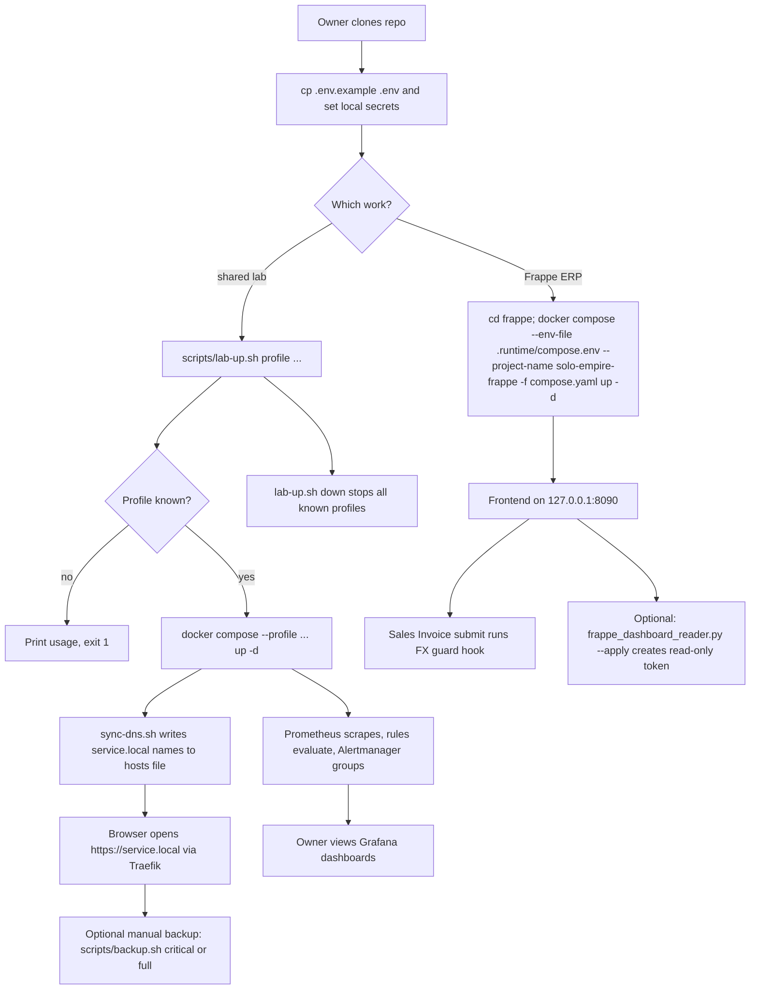
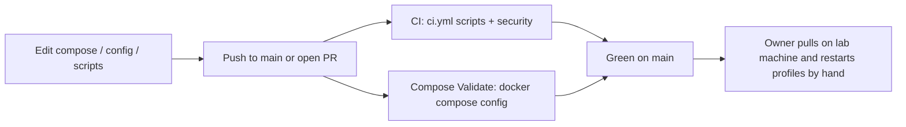
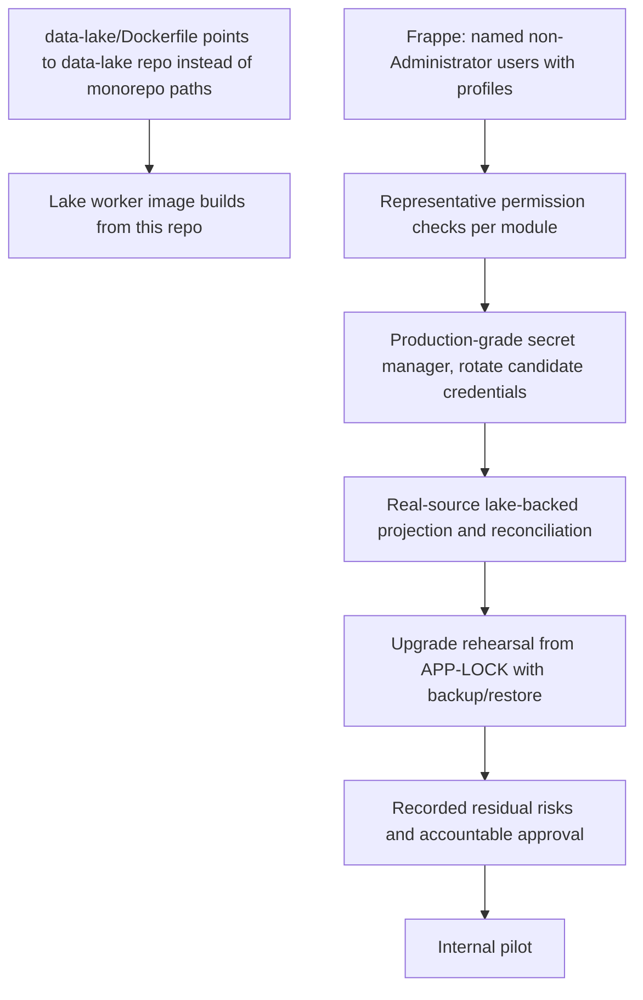

# 01 — Business process (As-Is / To-Be)

repo นี้เป็น Infrastructure-as-Code ของ lab ส่วนตัว ไม่ใช่ service ที่ host อยู่ (`PRODUCT.md`: "It is not hosted anywhere and has no live URL")
"business process" จึงคือขั้นตอนที่ owner ใช้งาน lab: เตรียม secret ใน `.env`, เปิด Compose ตาม profile, sync DNS ของ `*.local`, เข้าใช้ผ่าน Traefik และเปิด Frappe/ERPNext เป็น Compose project แยก

## As-Is (จากโค้ดวันนี้)

Sources: `infra/self-hosted-stack/scripts/lab-up.sh`, `infra/self-hosted-stack/sync-dns.sh`, `infra/self-hosted-stack/docker-compose.yml`, `infra/self-hosted-stack/frappe/README.md`, `infra/self-hosted-stack/frappe/compose.yaml`, `infra/self-hosted-stack/frappe/custom-apps/solo_empire_fx_guard/solo_empire_fx_guard/hooks.py`, `infra/scripts/sync/frappe_dashboard_reader.py`, `infra/self-hosted-stack/scripts/backup.sh`, `infra/self-hosted-stack/prometheus/prometheus.yml`, `PRODUCT.md`

### Change process (repo level, As-Is)

Sources: `.github/workflows/ci.yml`, `.github/workflows/compose-validate.yml`, `PRODUCT.md` ("The stack is started by hand on the lab machine; nothing deploys from `main`.")

## To-Be (เฉพาะที่ repo docs ระบุ)

ไม่มี `specs/` หรือ `docs/UPGRADE-PLAN.md` และ GitHub issues ว่าง (`gh issue list` คืนค่าว่าง) To-Be ที่มีหลักฐานจึงมาจาก `PRODUCT.md` (Limits), `README.md` (หมายเหตุ) และ promotion gates ของ Frappe ใน `frappe/SECURITY-READINESS.md`

Sources: `PRODUCT.md` (Limits), `README.md` (หมายเหตุ), `.trivyignore.yaml`, `infra/self-hosted-stack/frappe/SECURITY-READINESS.md` (Promotion gates)

## Open questions

- To-Be ของ Compose lab เอง (เช่น ย้ายไป Kubernetes ตามที่ README ของ stack อ้างถึง `infra/platform/`) — path นั้นไม่มีใน repo นี้ จึงไม่ถือเป็น To-Be ที่ยืนยันได้
- จะเก็บ lab นี้เป็น `showcase` ต่อหรือ `archive` (DOCPACK product card ระบุว่า "จะเปลี่ยนเป็น `archive` หากเลิกใช้ lab")
