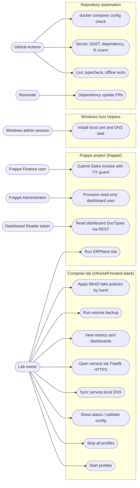

# 02 — Use cases

ไม่มีระบบ login ของ repo เอง actor จริงจึงมาจาก (1) ผู้ที่รัน script/compose บนเครื่อง lab (2) automation ใน GitHub (3) role/profile ของ Frappe ที่ define ไว้ใน `ROLE-PROFILES.yaml` และ role ที่ script สร้าง

| Actor | ที่มาในโค้ด |
|---|---|
| Lab owner (operator) | ผู้รัน `lab-up.sh`, `sync-dns.sh`, `backup.sh`, `docker compose` (ทุก README) |
| Windows admin session | `one-time-setup.ps1`, `setup-auto-dns.ps1` ต้องรันแบบ Administrator |
| GitHub Actions | `ci.yml`, `compose-validate.yml` |
| Renovate | `renovate.json` (schedule จันทร์ก่อน 9 โมง) |
| Frappe Administrator (break-glass) | `SECURITY-READINESS.md`, `ROLE-PROFILES.yaml` `administrator_policy: break-glass-only` |
| Frappe Finance user (submit invoice) | `hooks.py` `doc_events` Sales Invoice `before_submit` |
| Dashboard Reader (API token) | `frappe_dashboard_reader.py` `READER_ROLE` |

Sources: `infra/self-hosted-stack/scripts/lab-up.sh`, `infra/self-hosted-stack/sync-dns.sh`, `infra/self-hosted-stack/one-time-setup.ps1`, `infra/self-hosted-stack/setup-auto-dns.ps1`, `infra/self-hosted-stack/scripts/backup.sh`, `infra/self-hosted-stack/minio/policies/README.md`, `infra/self-hosted-stack/frappe/ROLE-PROFILES.yaml`, `infra/self-hosted-stack/frappe/SECURITY-READINESS.md`, `infra/self-hosted-stack/frappe/custom-apps/solo_empire_fx_guard/solo_empire_fx_guard/hooks.py`, `infra/scripts/sync/frappe_dashboard_reader.py`, `.github/workflows/ci.yml`, `.github/workflows/compose-validate.yml`, `renovate.json`

## Frappe role profiles (defined, ยังไม่มี named user)

`ROLE-PROFILES.yaml` define 7 profiles: Owner (ไม่ใช่ routine), Commercial, Finance, Delivery, Learning, HR, Support ตาม `SECURITY-READINESS.md` gate ข้อ 1 ยังต้องสร้าง named non-Administrator users — use case ของแต่ละ profile จึงเป็น "intended" ไม่ใช่ที่ใช้งานจริงแล้ว

## Open questions

- มี user อื่นนอกจาก owner ที่เข้าใช้ lab services หรือไม่ (เช่น Woodpecker ตั้ง `WOODPECKER_OPEN=true` ซึ่งเปิดให้ register ได้)
- oauth2-proxy (provider GitHub) ไม่ได้ผูกเป็น middleware ให้ router ใด — ตั้งใจให้เป็น actor/gate ของ use case ไหน
