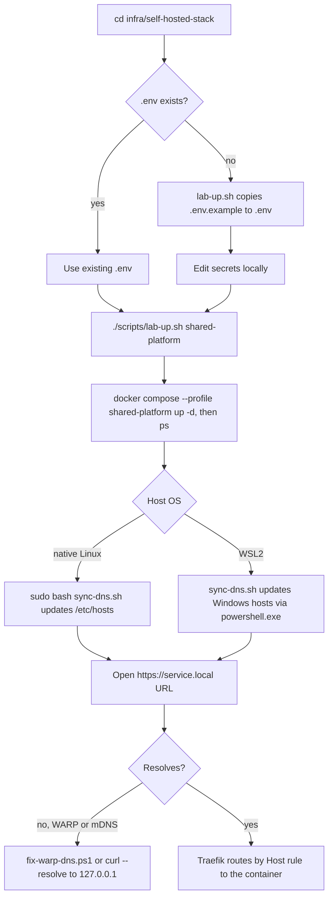
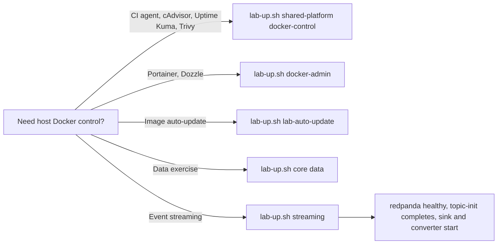
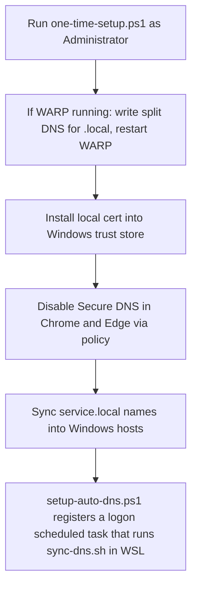
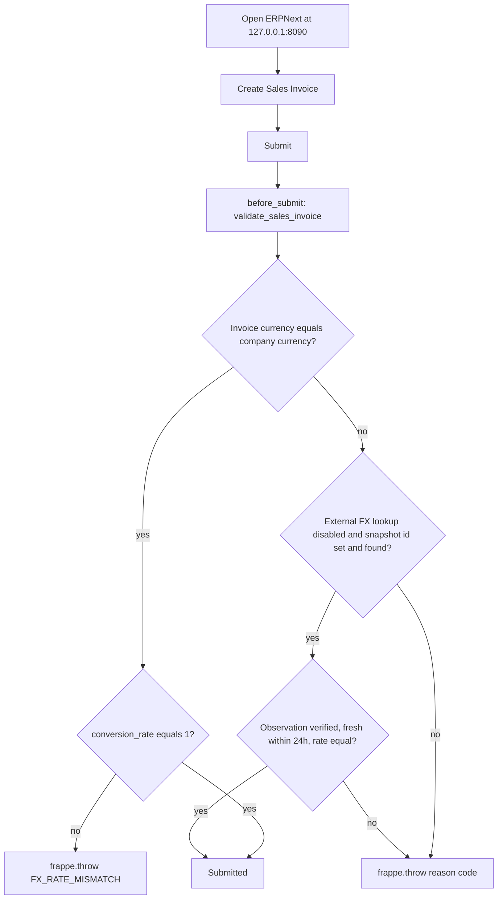
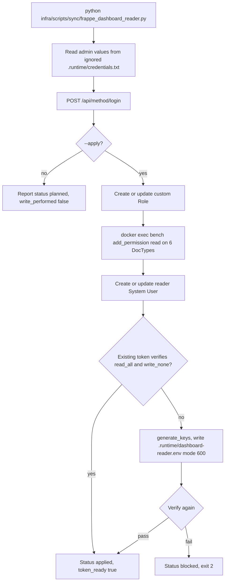

# 03 — User flows

ไม่มี UI ของ repo เอง "routes/pages" ในที่นี้คือ CLI entrypoints (`lab-up.sh`, `sync-dns.sh`, `backup.sh`, `frappe_dashboard_reader.py`) และ Traefik Host routers (61 rules รูปแบบ `<service>.local` ใน `docker-compose.yml`) flow แบ่งตาม actor ใน [02-use-cases.md](02-use-cases.md)

## Flow A — Lab owner: เปิด shared platform ครั้งแรก

Sources: `infra/self-hosted-stack/scripts/lab-up.sh`, `infra/self-hosted-stack/sync-dns.sh`, `infra/self-hosted-stack/fix-warp-dns.ps1`, `infra/self-hosted-stack/PROFILES.md` (DNS section), `infra/self-hosted-stack/docker-compose.yml`

## Flow B — Lab owner: เลือก profile ที่เสี่ยงกว่า (opt-in)

Sources: `infra/self-hosted-stack/PROFILES.md`, `infra/self-hosted-stack/SERVICE-OWNERSHIP.md`, `infra/self-hosted-stack/docker-compose.yml` (`profiles`, `depends_on` ของ `redpanda-topic-init`, `stream-sink`, `stream-converter`)

## Flow C — Windows admin: one-time setup

Sources: `infra/self-hosted-stack/one-time-setup.ps1`, `infra/self-hosted-stack/setup-auto-dns.ps1`, `infra/self-hosted-stack/README.md` (DNS & HTTPS Setup)

## Flow D — Frappe Finance user: submit Sales Invoice

หมายเหตุ: app นี้ "not installed on the main site by default" (custom app README) — flow นี้เกิดเฉพาะ site ที่ติดตั้ง app แล้ว

Sources: `infra/self-hosted-stack/frappe/custom-apps/solo_empire_fx_guard/solo_empire_fx_guard/fx_guard.py`, `.../hooks.py`, `.../install.py`, `infra/self-hosted-stack/frappe/custom-apps/solo_empire_fx_guard/README.md`, `infra/self-hosted-stack/frappe/compose.yaml` (frontend port)

## Flow E — Frappe Administrator: provision dashboard reader

Sources: `infra/scripts/sync/frappe_dashboard_reader.py`, `infra/tests/integrations/frappe_dashboard_reader_test.py`

## Open questions

- Flow ของ consumer ที่อ่าน token file (`dashboard-reader.env`) อยู่นอก repo นี้ (README อ้าง dashboard `frappe_client.ts`) — ไม่ได้วาดเพราะไม่มีโค้ดที่นี่
- `traefik/dynamic/*.yml` (TLS config) ถูก gitignore จึงยืนยันไม่ได้ว่า cert ที่ Traefik เสิร์ฟคือ `traefik/certs/local.crt`
