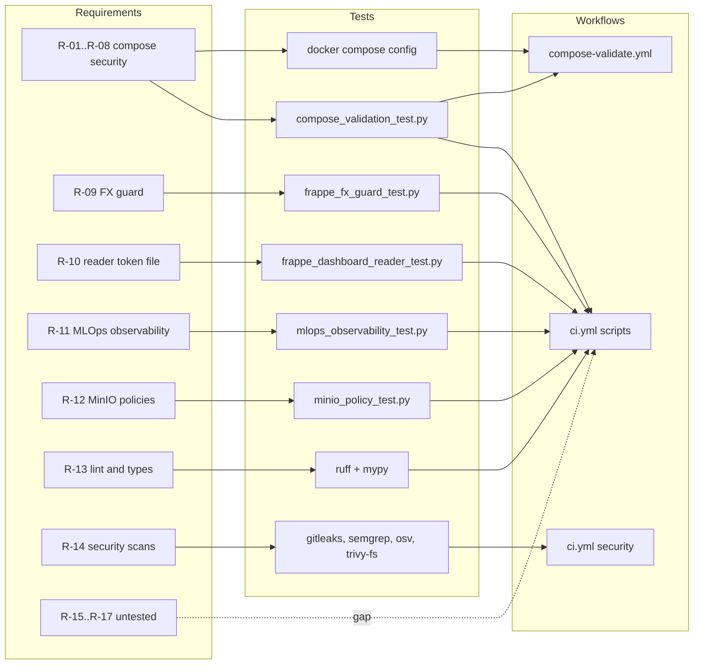

# 04 — Traceability (RTM)

ไม่มี `specs/` หรือ SRS ใน repo requirement จึงดึงจาก claim ที่เขียนไว้จริงใน `PRODUCT.md` ("What works today"), header ของ `docker-compose.yml`, `frappe/SECURITY-READINESS.md` และ `minio/policies/README.md` ID (`R-xx`) ตั้งขึ้นในเอกสารนี้เพื่ออ้างอิงเท่านั้น

"Release/workflow" = workflow ที่รัน test นั้นบน GitHub (repo นี้ไม่มี deploy)

| ID | Requirement (source) | Code / config module | Test | Release / workflow |
|---|---|---|---|---|
| R-01 | Compose validates with placeholder `.env.example` (`PRODUCT.md`) | `infra/self-hosted-stack/docker-compose.yml` | `docker compose -f docker-compose.yml config --quiet` step | `compose-validate.yml` job `compose-config` |
| R-02 | Lab-only warning header in compose (compose header) | `docker-compose.yml` lines 1–15 | `compose_validation_test.py` `test_compose_security` | `ci.yml` `scripts`, `compose-validate.yml` |
| R-03 | No hardcoded secrets in compose; secrets from env (`README.md` Credentials) | `docker-compose.yml` `${VAR}` forms | `compose_validation_test.py` | same |
| R-04 | Traefik bound to localhost, dashboard unpublished, `insecure: false` (stack README) | `docker-compose.yml` `traefik.ports`, `traefik/traefik.yml` `api` | `compose_validation_test.py` | same |
| R-05 | Traefik reaches Docker only via read-only proxy on internal network (stack README) | `traefik/traefik.yml` `providers.docker.endpoint`, `docker-socket-proxy` env, `docker-control-net internal: true` | `compose_validation_test.py` | same |
| R-06 | Direct Docker socket consumers allow-listed and behind opt-in profiles (`PROFILES.md`) | `docker-compose.yml` services with `/var/run/docker.sock` | `compose_validation_test.py` (`allowed_socket_services`, `profile_expectations`) | same |
| R-07 | CoreDNS host ports on localhost only (`PROFILES.md` notes) | `docker-compose.yml` `coredns.ports` | `compose_validation_test.py` | same |
| R-08 | `:latest` images limited to an allow-list | `docker-compose.yml` images | `compose_validation_test.py` `LAB_LATEST_ALLOW` | same |
| R-09 | FX guard fails closed on Sales Invoice submit (`PRODUCT.md`, custom app README) | `solo_empire_fx_guard/fx_guard.py`, `hooks.py` | `infra/tests/integrations/frappe_fx_guard_test.py` (7 tests) | `ci.yml` `scripts` |
| R-10 | Dashboard reader token file minimal, mode 600, parser ignores extra keys | `infra/scripts/sync/frappe_dashboard_reader.py` `write_token_file`, `read_key_value_file` | `infra/tests/integrations/frappe_dashboard_reader_test.py` (2 tests) | `ci.yml` `scripts` |
| R-11 | MLOps scrape target empty by default; rules + dashboard present (`prometheus.yml` comment) | `prometheus/mlops-targets.json`, `prometheus/rules.yml` group `mlops-reference`, `grafana/.../mlops-reference.json` | `infra/tests/mlops/mlops_observability_test.py` (3 tests) | `ci.yml` `scripts` |
| R-12 | MinIO lake policies least-privilege, no secrets (`minio/policies/README.md`) | `minio/policies/lake-*.json` | `infra/tests/data_lake/minio_policy_test.py` (6 tests) | `ci.yml` `scripts` |
| R-13 | Strict mypy + Ruff over scripts and custom app (`PRODUCT.md`) | `pyproject.toml` `[tool.mypy]`, `uv.lock` | reusable `ci-python.yml` Lint + Typecheck steps | `ci.yml` `scripts` |
| R-14 | Secret/SAST/dependency/filesystem scanning (`PRODUCT.md` shared CI) | whole repo; `.trivyignore.yaml` | reusable `security.yml` jobs gitleaks, semgrep, osv-scanner, trivy-fs | `ci.yml` `security` |
| R-15 | Frappe frontend bound to `127.0.0.1:8090`; DB/Redis internal (`SECURITY-READINESS.md`) | `frappe/compose.yaml` `frontend.ports` | **gap: no automated test** | none (frappe compose ไม่ถูก validate ใน CI) |
| R-16 | Backup of critical volumes (`backup.sh` header) | `scripts/backup.sh` | **gap: no test** | none |
| R-17 | Profiles start/stop correctly (`PROFILES.md`) | `scripts/lab-up.sh` | **gap: no test** (CI ไม่รัน `up`) | none |

Sources: `PRODUCT.md`, `README.md`, `.github/workflows/ci.yml`, `.github/workflows/compose-validate.yml`, `infra/tests/**`, `infra/self-hosted-stack/docker-compose.yml`, `infra/self-hosted-stack/traefik/traefik.yml`, `infra/self-hosted-stack/frappe/SECURITY-READINESS.md`, `infra/self-hosted-stack/minio/policies/README.md`, platform-ci-workflows `ci-python.yml` / `security.yml` @ `87dc5e1c`

## Open questions

- ควรมี formal requirement set (SRS) แทนการอ้าง claim ใน README/PRODUCT หรือไม่
- `compose_validation_test.py` docstring บอกว่าเช็ค Helm/Kyverno/GitOps ใต้ `infra/platform/` ด้วย แต่ใน repo นี้ function ที่รันจริงมีแค่ `test_compose_security` — ควรแก้ docstring (นอก scope docs นี้)
