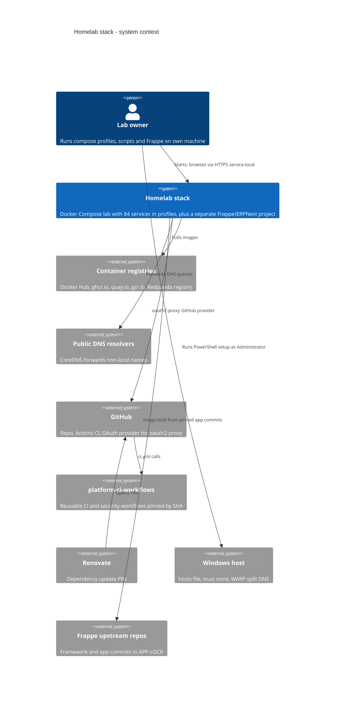

# 05 — C4 Context

ระบบ = "Homelab stack" (repo นี้) ซึ่งรันบนเครื่อง lab ของ owner เท่านั้น ระบบภายนอกคือสิ่งที่ config/script ติดต่อจริง

Sources: `infra/self-hosted-stack/docker-compose.yml` (images, `oauth2-proxy` env), `infra/self-hosted-stack/coredns/Corefile` (`forward`), `.github/workflows/ci.yml`, `renovate.json`, `infra/self-hosted-stack/one-time-setup.ps1`, `infra/self-hosted-stack/frappe/APP-LOCK.yaml`, `infra/self-hosted-stack/frappe/compose.yaml`, `PRODUCT.md`

## หมายเหตุ

- ไม่มี hosted runtime: ไม่มี Railway / Vercel / Cloudflare deploy และไม่มี Sentry (`PRODUCT.md` Sentry waiver)
- Homer dashboard (`homer/config.yml`) มีกลุ่มลิงก์ "Homelab K3s" ไปยัง services ภายนอก repo (NetBox, AI Doc Assistant, BooknBook, Platform Smoke) — เป็นแค่ลิงก์ ไม่มี dependency ระดับ runtime จึงไม่วาดเป็นระบบภายนอก (host ของลิงก์เป็น private address จึงไม่คัดลอกมา)
- `traefik.yml` ไม่มี ACME resolver; volume `traefik-certs:/letsencrypt` ถูก mount แต่ไม่มี config ที่ใช้ จึงไม่วาด Let's Encrypt

## Open questions

- K3s homelab ที่ Homer ลิงก์ไปถูกจัดการด้วย repo ไหน
