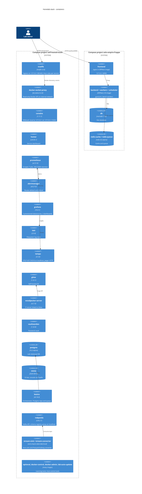
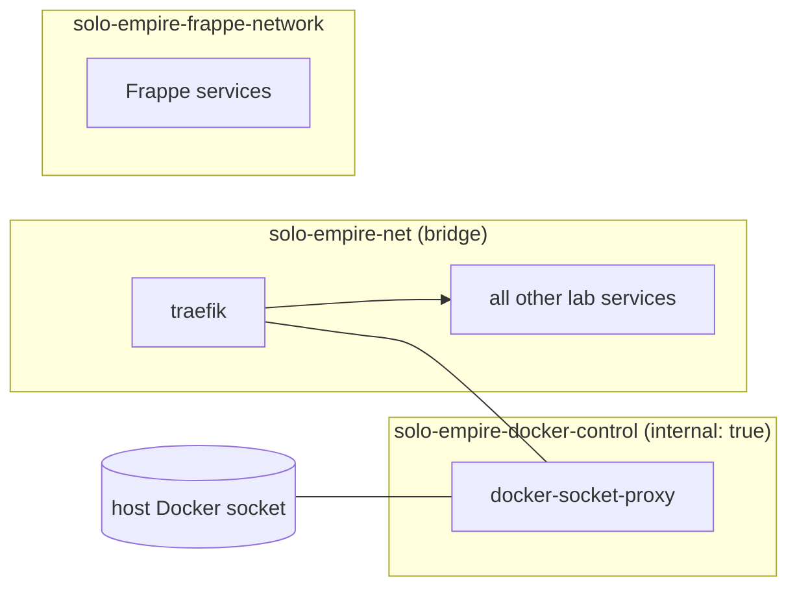

# 06 — C4 Container

Compose file มี 84 services, 2 networks (`solo-empire-net` bridge, `solo-empire-docker-control` bridge `internal: true`) และ 70 named volumes ภาพนี้แสดง container หลักของ profile ที่ใช้บ่อย (`core`, `observability`, `devsecops`, `data`, `streaming`) ส่วน `optional` (38 services), `disabled` (4) และ admin/control profiles สรุปเป็นกล่องเดียว

จำนวนต่อ profile (นับจาก `profiles:` ใน compose; service หนึ่งอยู่ได้หลาย profile): optional 38, shared-platform 19, data 12, observability 9, devsecops 7, docker-control 7, core 4, streaming 4, disabled 4, docker-admin 2, lab-auto-update 1

Sources: `infra/self-hosted-stack/docker-compose.yml`, `infra/self-hosted-stack/traefik/traefik.yml`, `infra/self-hosted-stack/coredns/Corefile`, `infra/self-hosted-stack/prometheus/prometheus.yml`, `infra/self-hosted-stack/grafana/provisioning/datasources/prometheus.yml`, `infra/self-hosted-stack/grafana/provisioning/dashboards/*.json`, `infra/self-hosted-stack/tempo/tempo.yml`, `infra/self-hosted-stack/loki/loki.yml`, `infra/self-hosted-stack/frappe/compose.yaml`, `infra/self-hosted-stack/PROFILES.md`

## Networks

Sources: `infra/self-hosted-stack/docker-compose.yml` (`networks`, `traefik.networks`, `docker-socket-proxy.networks`), `infra/self-hosted-stack/frappe/compose.yaml` (`networks.default.name`)

## ความไม่ตรงกันที่พบ (gaps)

- `README.md` ของ stack และ `gatus/config.yaml` อ้างถึง services ที่ **ไม่มี** ใน compose ปัจจุบัน เช่น Gatus, AdGuard, Synapse, Gotify, Wiki.js, Ollama, Jupyter, Nginx, RabbitMQ (README เองเตือนว่า "current Compose service/profile inventory is the source of truth")
- ตาราง Port Mappings ใน stack README แสดง host ports หลายตัว (เช่น 3004, 5432) แต่ compose publish host ports เฉพาะ traefik, coredns, redpanda และ tempo (ทั้งหมด bind `127.0.0.1`)
- `stream-sink` / `stream-converter` build จาก `data-lake/Dockerfile` ที่ COPY `scripts/data_lake` ซึ่งไม่มีใน repo นี้ (`PRODUCT.md` Limits)

## Open questions

- `woodpecker-server` อยู่ใน `shared-platform` ด้วย แต่ `woodpecker-agent` อยู่แค่ `docker-control` — ใน shared-platform อย่างเดียวจึงไม่มี agent รัน pipeline ตั้งใจหรือไม่
