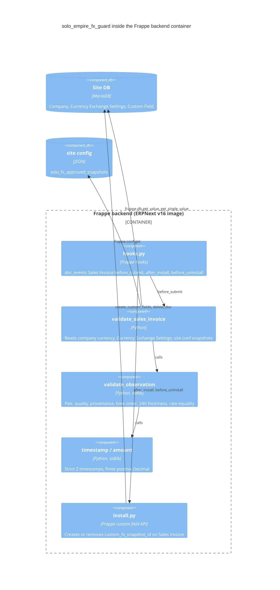
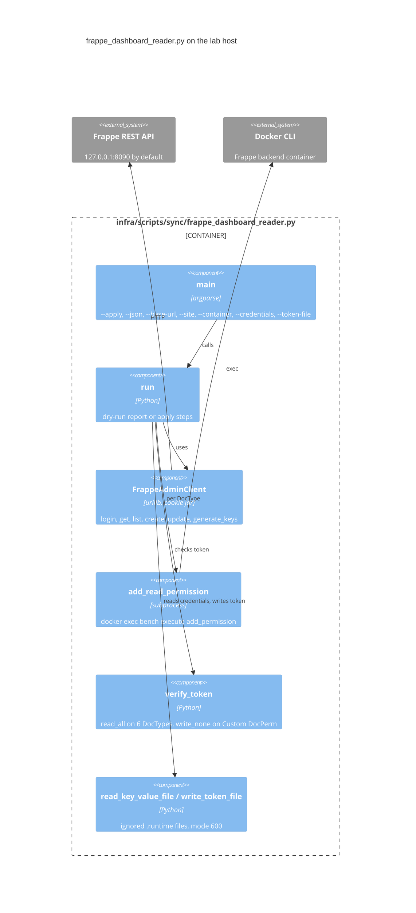

# 07 — C4 Component

โค้ดที่ repo เขียนเองมีสองชิ้น: Frappe custom app `solo_empire_fx_guard` (รันใน Frappe backend) และ script `frappe_dashboard_reader.py` (รันบน host) นอกนั้นเป็น config ของ image ภายนอก ภาพที่ 3 แสดง component ภายใน Prometheus config

## A. FX guard ภายใน Frappe backend

Sources: `infra/self-hosted-stack/frappe/custom-apps/solo_empire_fx_guard/solo_empire_fx_guard/hooks.py`, `.../fx_guard.py`, `.../install.py`, `.../commands.py` (ไม่มี bench commands)

## B. Dashboard reader provisioning script

Sources: `infra/scripts/sync/frappe_dashboard_reader.py`, `infra/tests/integrations/frappe_dashboard_reader_test.py`

## C. Monitoring config components

```mermaid
flowchart LR
    subgraph promcfg["prometheus/prometheus.yml"]
        J1["job prometheus"]
        J2["job node-exporter"]
        J3["job traefik"]
        J4["job loki"]
        J5["job influxdb"]
        J6["job tempo"]
        J7["job solo-empire-mlops-reference via file_sd, empty"]
    end
    subgraph rules["prometheus/rules.yml"]
        G1["infrastructure: 6 rules"]
        G2["traefik: 2 rules"]
        G3["services: 3 rules"]
        G4["mlops-reference: 3 rules"]
        G5["databases: 3 rules"]
    end
    subgraph amcfg["alertmanager/alertmanager.yml"]
        RT["route group_by alertname, severity"]
        RD["receiver default"]
        RC["receiver critical"]
    end
    promcfg --> rules
    rules --> RT
    RT -->|"severity critical"| RC
    RT -->|"severity warning or other"| RD
```

Sources: `infra/self-hosted-stack/prometheus/prometheus.yml`, `infra/self-hosted-stack/prometheus/rules.yml`, `infra/self-hosted-stack/prometheus/mlops-targets.json`, `infra/self-hosted-stack/alertmanager/alertmanager.yml`

## Test-only components

- `infra/scripts/sync/frappe_fx_guard.py` — import shim ที่เพิ่ม `custom-apps/` เข้า `sys.path` เพื่อให้ test รันนอก Frappe
- `infra/scripts/platform/platform_output.py` — `configure_utf8_stdio()` ใช้โดย `compose_validation_test.py`

## Open questions

- ใครเป็นผู้เขียน `solo_fx_approved_snapshots` ลง site config — app "does not fetch rates, write snapshots" (custom app README) จึงเป็นงาน operator ที่ไม่มี tooling ใน repo
