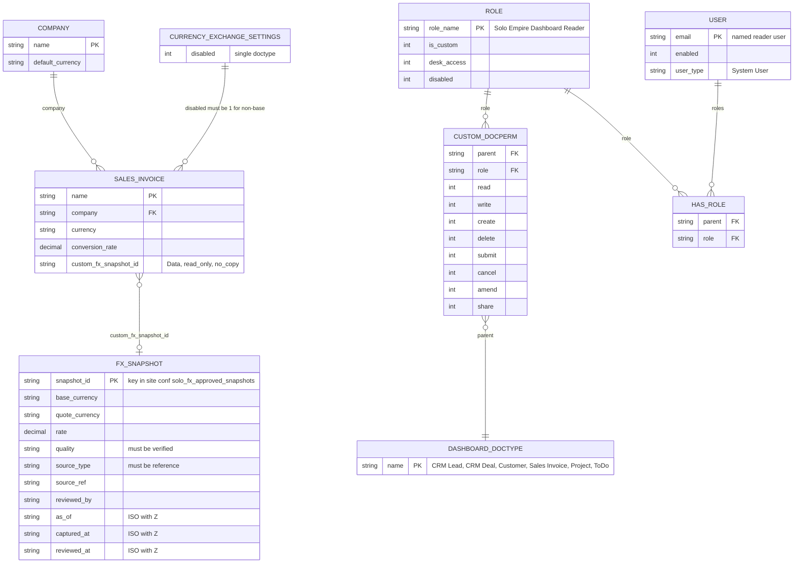
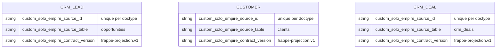
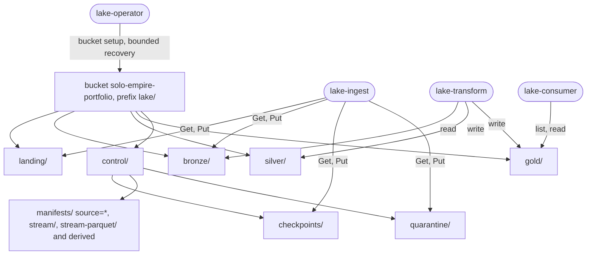

# 09 — ERD

repo ไม่มี migration หรือ ORM ของตัวเอง ข้อมูล persisted ที่ repo **define หรือเขียน** มีสองกลุ่ม:

1. Frappe records ที่ custom app และ script สร้าง/อ่าน (custom field, role, user, permission, snapshot ใน site config)
2. MinIO lake prefix layout ที่ policy JSON ผูกสิทธิ์ไว้

ข้อมูลของ third-party services อื่น (Gitea, Vaultwarden, Postgres ฯลฯ) อยู่ใน named volumes โดย schema เป็นของ upstream — ดู data-store map ใน [14-backup-dr.md](14-backup-dr.md)

## A. Frappe entities ที่ repo แตะ

Sources: `infra/self-hosted-stack/frappe/custom-apps/solo_empire_fx_guard/solo_empire_fx_guard/fx_guard.py`, `.../install.py`, `infra/scripts/sync/frappe_dashboard_reader.py` (`DASHBOARD_DOCTYPES`, `run`, `verify_token`), `infra/tests/integrations/frappe_fx_guard_test.py` (snapshot fields)

## B. Projection identity fields (catalog, Frappe)

`SOURCE-ID-FIELDS.yaml` ระบุ custom fields 3 ตัวบน `CRM Lead` (source `opportunities`), `Customer` (source `clients`), `CRM Deal` (source `crm_deals`) โดย `SECURITY-READINESS.md` ระบุว่า "created on `CRM Lead`, `Customer`, and `CRM Deal`" — แต่ใน repo นี้ไม่มีโค้ดที่สร้าง fields เหล่านี้

Sources: `infra/self-hosted-stack/frappe/SOURCE-ID-FIELDS.yaml`, `infra/self-hosted-stack/frappe/SECURITY-READINESS.md`

## C. Lake object layout ที่ MinIO policies ผูกไว้

Sources: `infra/self-hosted-stack/minio/policies/README.md`, `infra/self-hosted-stack/minio/policies/lake-ingest.json`, `lake-transform.json`, `lake-consumer.json`, `lake-operator.json`, `infra/tests/data_lake/minio_policy_test.py`

## Open questions

- `FX_SNAPSHOT` ไม่ใช่ DocType แต่เป็น dict ใน site config — ผู้เขียน/ผู้ review และ retention ไม่ได้ define
- Policies ถูก apply ใน MinIO ของ lab แล้วหรือยัง (README: "This repository does not create users ... or apply policies automatically")
