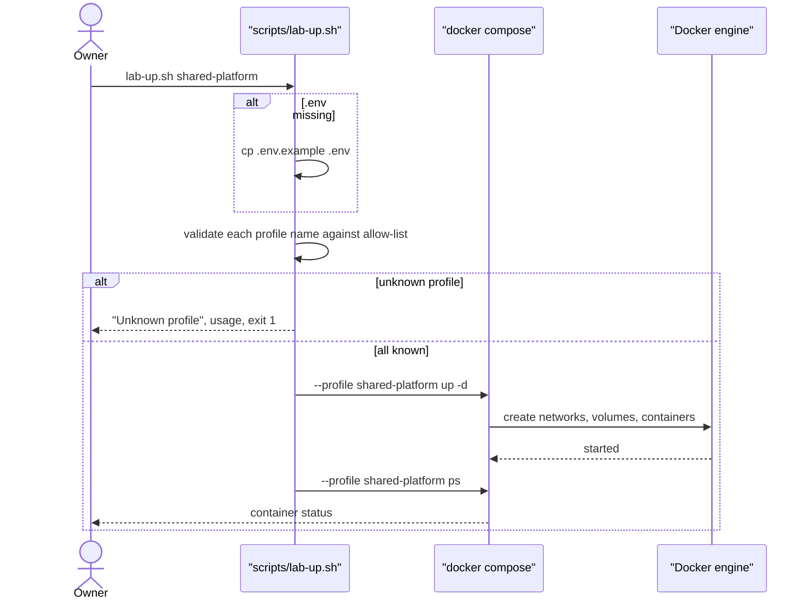
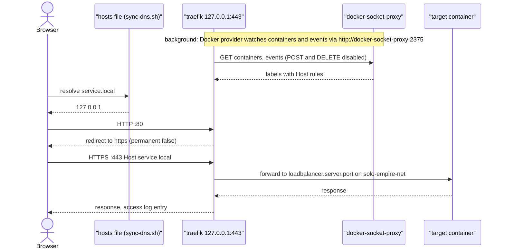
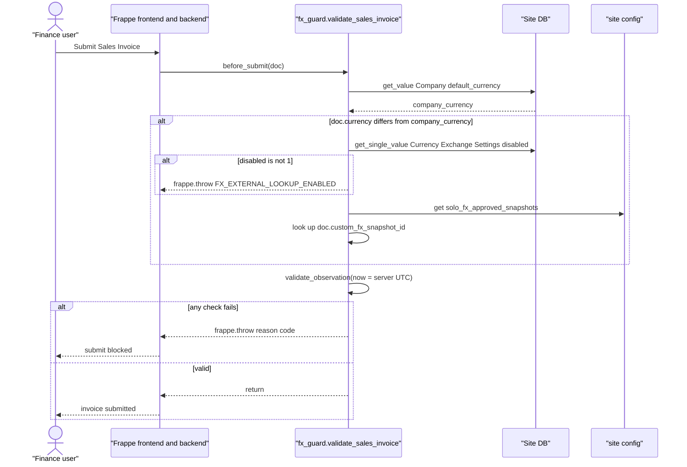
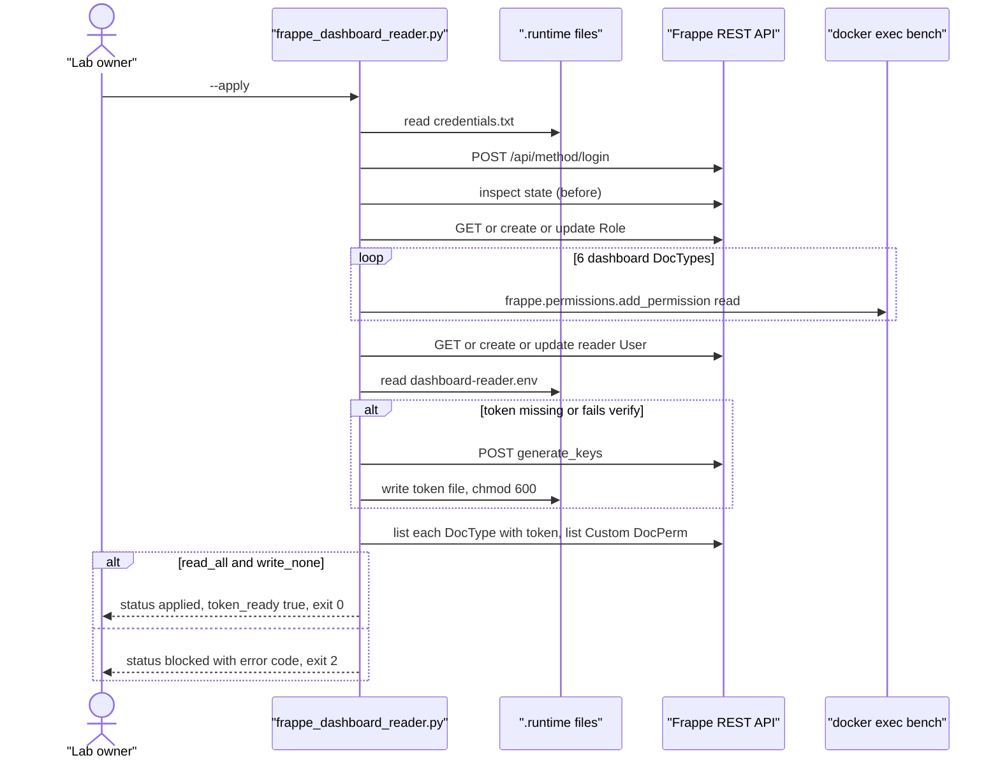

# 10 — Sequences

4 เส้นทางหลัก: (1) เปิด profile ด้วย `lab-up.sh` (2) HTTPS request ไปยัง service ผ่าน Traefik (3) submit Sales Invoice ผ่าน FX guard (4) provision dashboard reader

## 1. Start profiles

Sources: `infra/self-hosted-stack/scripts/lab-up.sh`, `infra/self-hosted-stack/docker-compose.yml`

## 2. Browser to a lab service via Traefik

Sources: `infra/self-hosted-stack/traefik/traefik.yml`, `infra/self-hosted-stack/docker-compose.yml` (`traefik`, `docker-socket-proxy`, per-service labels), `infra/self-hosted-stack/sync-dns.sh`, `infra/self-hosted-stack/coredns/Corefile`

หมายเหตุ: CoreDNS ก็ตอบ `*.local` เป็น `127.0.0.1` ได้บน `127.0.0.1:15353` แต่ไม่มี config ใน repo ที่ชี้ระบบ host ให้ใช้ CoreDNS — browser จึง resolve ผ่าน hosts file ตาม `sync-dns.sh`

## 3. Sales Invoice submit with FX guard

Sources: `infra/self-hosted-stack/frappe/custom-apps/solo_empire_fx_guard/solo_empire_fx_guard/fx_guard.py`, `.../hooks.py`, `infra/tests/integrations/frappe_fx_guard_test.py`

## 4. Dashboard reader provisioning (`--apply`)

Sources: `infra/scripts/sync/frappe_dashboard_reader.py`, `infra/tests/integrations/frappe_dashboard_reader_test.py`

## Open questions

- Sequence ของ streaming (`redpanda` → `stream-sink` → Avro → `stream-converter` → Parquet/Iceberg) ไม่ได้วาดละเอียด เพราะโค้ด `/app/data_lake/stream_sink.py` ไม่อยู่ใน repo นี้ (มีแค่ command args ใน compose)
