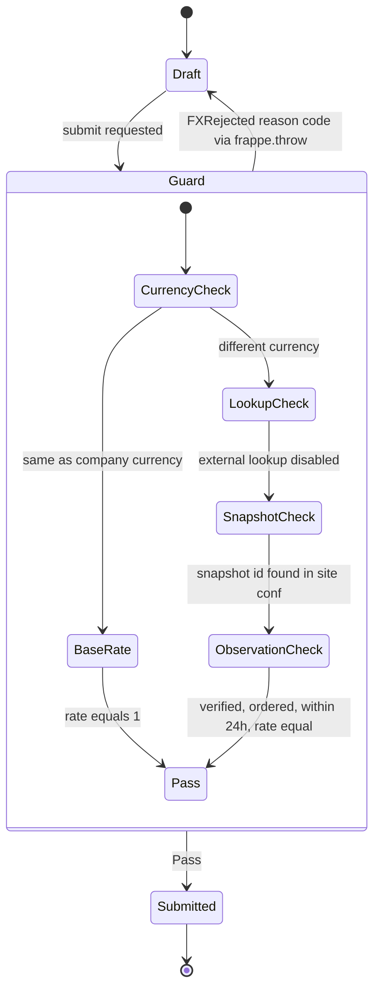
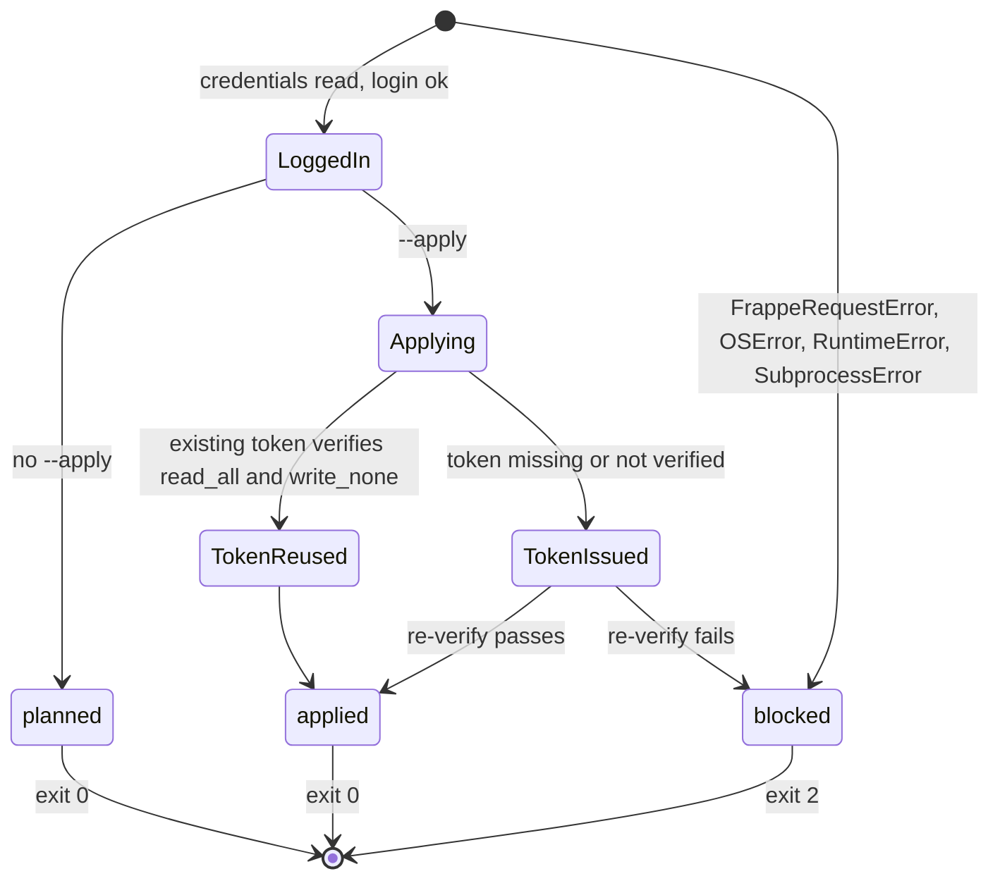
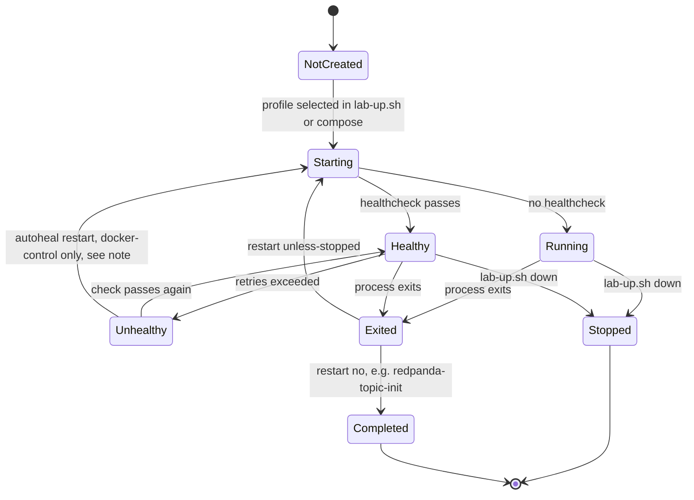
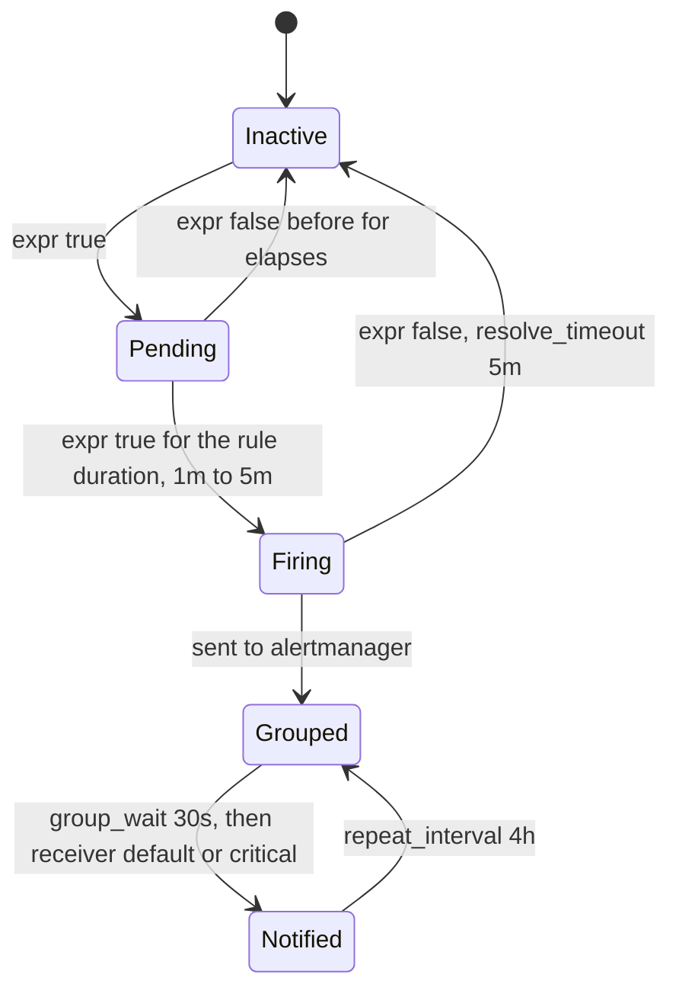

# 11 — State machines

entities ที่มี lifecycle ในโค้ดของ repo นี้:

1. Sales Invoice submit ที่ถูก FX guard คุม (เฉพาะ transition `before_submit`)
2. ผลของ `frappe_dashboard_reader.py` (`status`: planned / applied / blocked)
3. Container lifecycle ตาม profile + healthcheck / `restart` / `depends_on` conditions ใน compose
4. Prometheus alert (ตาม `for:` ใน rules) และ Alertmanager grouping

## 1. Sales Invoice submit guarded by FX guard

repo ไม่ได้เปลี่ยน lifecycle มาตรฐานของ Frappe (`docstatus`) แต่เพิ่ม guard บน transition Draft → Submitted

Reason codes ที่ `fx_guard.py` ใช้: `FX_CURRENCY_MISSING`, `FX_RATE_MISMATCH`, `FX_SNAPSHOT_MISSING`, `FX_DIRECT_PAIR_REQUIRED`, `FX_SNAPSHOT_UNVERIFIED`, `FX_PROVENANCE_MISSING`, `FX_TIME_ALIGNMENT_INVALID`, `FX_SNAPSHOT_STALE`, `FX_RATE_INVALID`, `FX_EXTERNAL_LOOKUP_ENABLED`

Sources: `infra/self-hosted-stack/frappe/custom-apps/solo_empire_fx_guard/solo_empire_fx_guard/fx_guard.py`, `.../hooks.py`

## 2. Dashboard reader run status

Sources: `infra/scripts/sync/frappe_dashboard_reader.py` (`run`, `main`)

## 3. Container lifecycle in the lab

หมายเหตุ autoheal: ใน compose ไม่มี container ใดติด label `autoheal` และ service `autoheal` ไม่ได้ตั้ง env เปลี่ยน label filter — ถ้า upstream default ยังกรองด้วย label นั้น transition นี้จะไม่เกิดจริง (open question) ในทำนองเดียวกัน `watchtower` ตั้ง `WATCHTOWER_LABEL_ENABLE=true` แต่ไม่มี container ที่ติด label enable

ตัวอย่าง conditions จริง: `redpanda-topic-init` รอ `redpanda: service_healthy`; `stream-sink` และ `stream-converter` รอ `redpanda-topic-init: service_completed_successfully`; `kestra` รอ `postgres: service_healthy`; Frappe `configurator` รอ `db: service_healthy` และ backend services รอ `configurator: service_completed_successfully`

Sources: `infra/self-hosted-stack/docker-compose.yml` (`healthcheck`, `restart`, `depends_on`, `autoheal`), `infra/self-hosted-stack/frappe/compose.yaml`, `infra/self-hosted-stack/scripts/lab-up.sh`

## 4. Prometheus alert lifecycle

หมายเหตุ: receivers `default` และ `critical` ไม่มี integration (ไม่มี email/webhook/chat config) — state "Notified" จึงไม่ส่งไปที่ใดจริง (gap, ดู [20-observability.md](20-observability.md))

Sources: `infra/self-hosted-stack/prometheus/rules.yml`, `infra/self-hosted-stack/alertmanager/alertmanager.yml`

## Open questions

- Stream sink/converter status files (`/var/lib/solo-empire/state/*.json`) มี state อะไรบ้าง — โค้ดอยู่ใน data-lake repo ไม่ใช่ที่นี่
