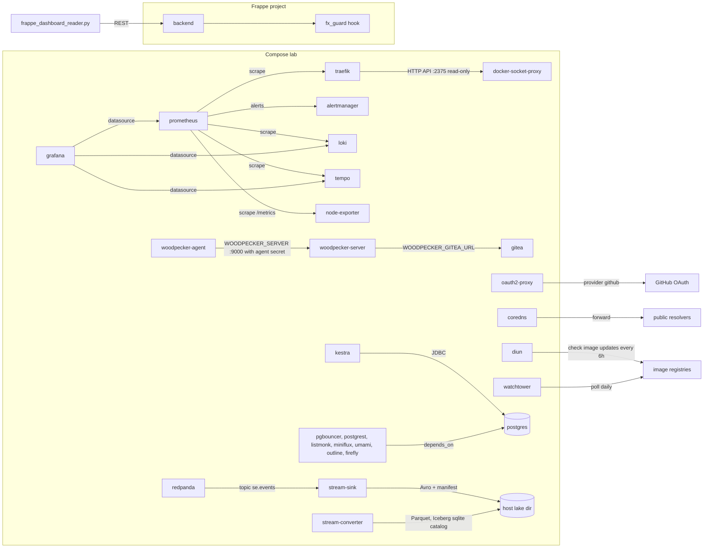

# 12 — API & integrations

repo นี้ **ไม่ได้ serve API ของตัวเอง** ส่วนที่เป็น "endpoint" คือ (ก) ingress ที่ Traefik เปิด (ข) host ports ที่ publish บน localhost (ค) Frappe REST endpoints ที่ script เรียก และ (ง) integration ระหว่าง containers

## A. Exposed surfaces (host)

| Surface | Bind | Service | Source |
|---|---|---|---|
| HTTP / HTTPS ingress, 61 Host rules `<service>.local` | `127.0.0.1:80`, `127.0.0.1:443` | traefik | `docker-compose.yml` |
| DNS (udp + tcp) | `127.0.0.1:15353` | coredns | `docker-compose.yml` |
| Kafka API, Schema Registry, HTTP proxy, admin | `127.0.0.1:19092`, `:18081`, `:18082`, `:19644` | redpanda (profile `streaming`) | `docker-compose.yml` |
| OTLP gRPC / HTTP | `127.0.0.1:4317`, `127.0.0.1:4318` | tempo | `docker-compose.yml` |
| Frappe web | `127.0.0.1:8090` (`HTTP_PUBLISH_PORT`) | frappe frontend | `frappe/compose.yaml` |

Traefik `metrics.prometheus.entryPoint: web` ให้ Prometheus scrape `traefik:80/metrics` ภายใน network

## B. Frappe REST calls made by `frappe_dashboard_reader.py`

| Method | Path | Purpose |
|---|---|---|
| POST | `/api/method/login` | admin session (cookie) |
| GET | `/api/resource/{doctype}/{name}` | read Role / User |
| GET | `/api/resource/{doctype}` | list (with token for verification, `Custom DocPerm` for write check) |
| POST | `/api/resource/{doctype}` | create Role / User |
| PUT | `/api/resource/{doctype}/{name}` | update Role / User |
| POST | `/api/method/frappe.core.doctype.user.user.generate_keys` | issue API key pair for the reader |
| CLI | `docker exec <backend> bench --site <site> execute frappe.permissions.add_permission` | add read permission per DocType |

Auth header สำหรับ token reads อยู่ในรูป `Authorization: token <api_key>:<api_secret>` (สร้างใน `FrappeAdminClient.request`)

Sources: `infra/scripts/sync/frappe_dashboard_reader.py`

## C. Integration flows

Sources: `infra/self-hosted-stack/docker-compose.yml` (env, `depends_on`, commands of `woodpecker-*`, `oauth2-proxy`, `diun`, `watchtower`, `kestra`, `stream-*`), `infra/self-hosted-stack/traefik/traefik.yml`, `infra/self-hosted-stack/prometheus/prometheus.yml`, `infra/self-hosted-stack/grafana/provisioning/datasources/prometheus.yml`, `infra/self-hosted-stack/coredns/Corefile`, `infra/scripts/sync/frappe_dashboard_reader.py`

## D. Repository-level integrations

| Integration | How | Source |
|---|---|---|
| platform-ci-workflows | reusable workflows `ci-python.yml`, `security.yml` @ `87dc5e1c` (v1.1.1) | `.github/workflows/ci.yml` |
| Renovate | weekly updates, action digest pinning, monthly lock maintenance | `renovate.json` |
| Frappe upstream | framework + 7 apps pinned by commit | `frappe/APP-LOCK.yaml`, `frappe/apps.json.example` |

## Gaps

- Prometheus ไม่ได้ scrape `cadvisor`, `blackbox-exporter`, `pushgateway`, `graphite` แม้ทั้งหมดอยู่ใน compose (สามตัวหลังอยู่ใน `observability`)
- ไม่มี service ใดส่ง traces เข้า Tempo หรือ logs เข้า Loki ตาม config ใน repo (stack README: "No Vector container is enabled")
- `oauth2-proxy` ไม่ได้ผูกเป็น forward-auth กับ router ใด และตั้ง `OAUTH2_PROXY_EMAIL_DOMAINS=*`

## Open questions

- Traefik metrics อยู่บน entrypoint `web` ซึ่งมี redirection ไป https — scrape `traefik:80/metrics` ได้ 200 จริงหรือโดน redirect (ยืนยันไม่ได้จาก config อย่างเดียว)
