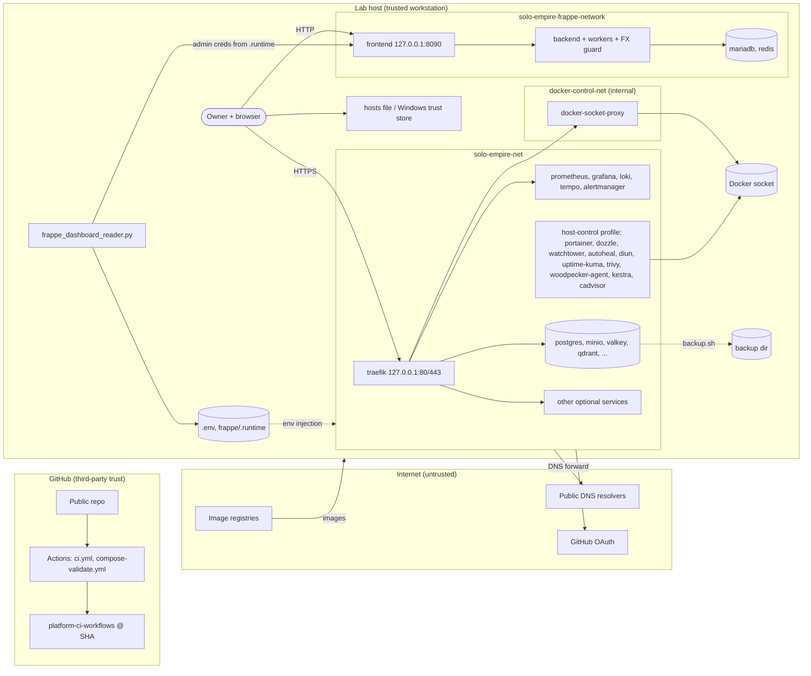

# 13 — Threat model

ขอบเขต: Compose lab + Frappe project บนเครื่อง lab และ GitHub repo/CI โมเดลนี้ตั้งสมมติฐานตาม header ของ compose: เครื่องเป็น "trusted local workstation" และ stack "must not be exposed to the public internet"

## DFD with trust boundaries

Sources: `infra/self-hosted-stack/docker-compose.yml`, `infra/self-hosted-stack/traefik/traefik.yml`, `infra/self-hosted-stack/coredns/Corefile`, `infra/self-hosted-stack/frappe/compose.yaml`, `infra/scripts/sync/frappe_dashboard_reader.py`, `infra/self-hosted-stack/scripts/backup.sh`, `.github/workflows/*.yml`, `.gitignore`, `infra/self-hosted-stack/.gitignore`

## STRIDE per element

| Element | Threat (STRIDE) | Existing mitigation in code | Gap |
|---|---|---|---|
| Traefik ingress | **S/I**: another host on LAN reaches services | ports bound `127.0.0.1` only; test `compose_validation_test.py` fails on `"80:80"` / `"443:443"` | ไม่มี auth middleware ใด ๆ บน 61 routers; ถ้ามีใครเปลี่ยน bind ทุก UI เปิดหมด |
| Traefik ingress | **E**: dashboard / API abuse | `api.insecure: false`, dashboard not routed, `traefik.enable=false` on itself | entrypoint `traefik :8088` ยังประกาศใน config (ไม่ publish) |
| Traefik ingress | **T/I**: TLS MITM | websecure TLS, local CA + cert installed by `one-time-setup.ps1` | TLS config ใน `traefik/dynamic/*.yml` ถูก gitignore — ไม่มีหลักฐานใน repo ว่า cert ไหนถูกเสิร์ฟ; redirect `permanent: false`, ไม่มี HSTS |
| docker-socket-proxy | **E**: container escape via Docker API | `POST=0`, `DELETE=0`, allow-list read endpoints, network `internal: true`, not on app network (tested) | proxy เองยัง mount socket แบบ read-write (ไม่มี `:ro`) |
| Host-control services | **E**: full host control | allow-listed + opt-in profiles (`docker-control`, `docker-admin`, `lab-auto-update`, `data`); tested | `kestra` รัน `user: root`, socket rw, `basic-auth.enabled: false`; `cadvisor` mount `/` และ `/var/run` แบบ `:ro` (ไม่ถูกจับโดย test เพราะไม่มี string `docker.sock`) |
| Woodpecker | **S/E**: anyone registers and runs pipelines | agent only in `docker-control` | `WOODPECKER_OPEN=true`; agent มี Docker socket |
| oauth2-proxy | **S**: weak identity gate | provider GitHub, secrets from env | `EMAIL_DOMAINS=*` และไม่ได้ผูกกับ router ใด — ไม่ได้ป้องกันอะไรจริง |
| Observability APIs | **I**: data exposure, **T**: log/trace injection | localhost bind via Traefik; Grafana `GF_USERS_ALLOW_SIGN_UP=false` | Loki `auth_enabled: false`; Tempo OTLP เปิดบน localhost ไม่มี auth; Prometheus/Alertmanager UI ไม่มี auth |
| Data stores | **I**: cross-project data leak | `SERVICE-OWNERSHIP.md` policy (per-project roles, no public exposure); MinIO least-privilege policies + test | policies ไม่ถูก apply อัตโนมัติ; postgres ใช้ root credential เดียวกันกับ kestra |
| Secrets (`.env`, `.runtime`) | **I**: secret committed | gitignored; `${VAR}` only; compose test regex; gitleaks in CI; token file mode 600; script never prints values | ไม่มี secret manager / rotation (`SECURITY-READINESS.md`: pending) |
| Frappe frontend | **S/E**: Administrator misuse | bound `127.0.0.1:8090`; Administrator break-glass policy; role profiles defined | ยังไม่มี named users (gate 1 open); `MYSQL_ROOT_PASSWORD` ใช้เป็น DB credential หลัก |
| FX guard | **T**: forged or stale FX rate on invoice | fail-closed checks, server clock, snapshot only from site conf, 10 reason codes, 7 tests | ไม่ได้ติดตั้งบน main site โดย default; snapshot authoring ไม่มี tooling/audit |
| Dashboard reader | **E**: reader token has write | verify `write_none` across 7 perm flags + `read_all`; blocked otherwise | admin password ถูกอ่านจาก plaintext `.runtime/credentials.txt` |
| CoreDNS | **S**: DNS spoofing of `.local` | bound `127.0.0.1:15353`; wildcard only for `.local` | forwards อื่น ๆ ไป public resolvers แบบ plain DNS |
| Images / supply chain | **T**: malicious image update | most images pinned by tag; pgbouncer by digest; `:latest` allow-list test; Renovate; Watchtower opt-in only | 4 images `:latest` อนุญาต (httpbin, excalidraw, nitter, breezewiki); tag ไม่ใช่ digest |
| Backups | **I/R**: unencrypted copies, no audit | local dir default under `$HOME`, 7-day retention | ไม่เข้ารหัส, ไม่ off-host, ไม่มี restore test |
| CI | **T**: compromised action | actions pinned by SHA, `permissions: contents: read`, reusable workflows pinned | `main` ไม่มี branch protection (direct push ได้) |
| Data-lake worker image | **E**: root in container | Trivy DS-0002 exception documented in `.trivyignore.yaml` | ยังรันเป็น root |

Sources: `infra/self-hosted-stack/docker-compose.yml`, `infra/self-hosted-stack/traefik/traefik.yml`, `infra/self-hosted-stack/loki/loki.yml`, `infra/self-hosted-stack/tempo/tempo.yml`, `infra/self-hosted-stack/coredns/Corefile`, `infra/self-hosted-stack/SERVICE-OWNERSHIP.md`, `infra/self-hosted-stack/minio/policies/*`, `infra/self-hosted-stack/frappe/SECURITY-READINESS.md`, `infra/self-hosted-stack/frappe/ROLE-PROFILES.yaml`, `infra/self-hosted-stack/frappe/compose.yaml`, `.../solo_empire_fx_guard/fx_guard.py`, `infra/scripts/sync/frappe_dashboard_reader.py`, `infra/tests/platform/compose_validation_test.py`, `.trivyignore.yaml`, `.github/workflows/ci.yml`, `infra/self-hosted-stack/scripts/backup.sh`

## Open questions

- ต้องการ forward-auth (oauth2-proxy) หน้าทุก router หรือยอมรับ "localhost = trusted" ต่อไป
- Frappe ควรถูกเพิ่มเข้า `compose-validate.yml` และ compose security checks หรือไม่
