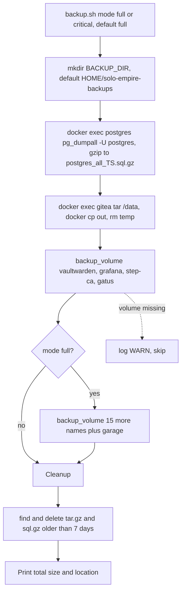

# 14 — Backup & DR

## Data ที่มีและอยู่ที่ไหน

ทั้งหมดอยู่บนเครื่อง lab เครื่องเดียว (Docker named volumes หรือ host directory) — ไม่มี managed DB หรือ cloud storage ใน repo นี้

| Data | Location | Backup in repo |
|---|---|---|
| PostgreSQL (lab DB, Kestra repo/queue) | volume `postgres-data` | `backup.sh` critical: `pg_dumpall` |
| Gitea repositories | volume `gitea-data` | `backup.sh` critical: tar inside container + `docker cp` |
| Vaultwarden | volume `vaultwarden-data` | `backup.sh` critical |
| Grafana | volume `grafana-data` | `backup.sh` critical |
| Step CA | volume `step-ca-data` | `backup.sh` critical |
| InfluxDB, Qdrant, Valkey, PocketBase, Listmonk, NATS, Mosquitto, Filebrowser | volumes `*-data` | `backup.sh` full only |
| MinIO objects | volume `minio-data` | **none** |
| Kestra storage | volume `kestra-data` | **none** |
| Redpanda log + streaming state | volumes `redpanda-data`, `streaming-state` | **none** (topic retention 24 h by design) |
| Lake files (Avro, Parquet, Iceberg sqlite catalog) | host dir `SOLO_EMPIRE_DATA_LAKE_PATH`, default `../../data/lake` | **none** in this repo |
| Prometheus TSDB (30 d), Loki, Tempo | volumes `prometheus-data`, `loki-data`, `tempo-data` | **none** |
| Woodpecker, Metabase, Outline, Uptime Kuma, others | volumes | **none** |
| Frappe site DB, sites, Redis queue | volumes `db-data`, `sites`, `logs`, `redis-queue-data` (project `solo-empire-frappe`) | **none in repo**; `SECURITY-READINESS.md` บันทึกว่า backup + disposable restore drill ผ่านสำหรับ candidate (ทำด้วยมือ) |
| Secrets `.env`, `frappe/.runtime/` | host files, gitignored | **none** |

Sources: `infra/self-hosted-stack/docker-compose.yml` (`volumes`, `x-data-lake-runtime`, `prometheus.command`), `infra/self-hosted-stack/scripts/backup.sh`, `infra/self-hosted-stack/frappe/compose.yaml`, `infra/self-hosted-stack/frappe/SECURITY-READINESS.md`, `.gitignore`

## Backup flow (`scripts/backup.sh`)

`backup_volume` รัน `alpine:latest` mount volume `self-hosted-stack_<name>` แบบ read-only แล้ว `tar -czf` ลง backup dir

Sources: `infra/self-hosted-stack/scripts/backup.sh`

## Backup/restore reality

- **Trigger:** manual เท่านั้น — header แสดงตัวอย่าง cron (`0 2 * * *`) แต่ไม่มี crontab, systemd timer หรือ workflow ใน repo ติดตั้งให้
- **Restore:** ไม่มี restore script หรือ restore drill สำหรับ Compose lab
- **Off-host / encryption:** ไม่มี — เก็บใน directory บนเครื่องเดียวกัน ไม่เข้ารหัส
- **Retention:** 7 วัน (`RETENTION_DAYS=7`)
- **Stale volume names:** `backup.sh` อ้าง volumes ที่ไม่มีใน compose ปัจจุบัน: `gatus-data`, `duckdb-data`, `prefect-data`, `wikijs-data`, `gotify-data`, `rabbitmq-data`, `ollama-data`, `jupyter-data`, `garage-data` (จะถูก skip ด้วย WARN)
- **Postgres user mismatch risk:** dump ใช้ `-U postgres` แต่ container สร้าง user จาก `${POSTGRES_USER}` และ healthcheck ใช้ `pg_isready -U solo` — ถ้า user ไม่ใช่ `postgres` dump จะล้ม
- **Error handling:** script ใช้ `set -euo pipefail` ดังนั้นคำสั่งที่ล้มจะหยุด script ทันที branch `else` ที่ log "Failed to backup" จะไม่ถูกเรียก
- **README mismatch:** คำสั่ง backup ตัวอย่างใน stack README ใช้ prefix `solo-empire-self-hosted-stack_` ต่างจาก `self-hosted-stack_` ใน `backup.sh`
- **Frappe:** มีหลักฐานเชิงเอกสารว่า backup/restore drill ผ่าน แต่ "off-host retention/DR remains unverified" (`SECURITY-READINESS.md`)

## RTO / RPO

- RTO: **not defined**
- RPO: **not defined** (ถ้ารัน cron รายวันตามตัวอย่าง RPO โดยนัยคือ ~24 ชั่วโมง แต่ไม่ได้ตั้งค่าไว้จริง)

## Open questions

- Compose project name จริงคืออะไร (ถ้า `.env` ตั้ง `COMPOSE_PROJECT_NAME` prefix volume จะไม่ใช่ `self-hosted-stack_`)
- Lake data ใน host dir ถูก backup โดย data-lake repo หรือ R2 mirror หรือไม่
- ต้องการให้ lab มี DR เลยหรือไม่ (ตาม `PRODUCT.md` ไม่มี production users)
