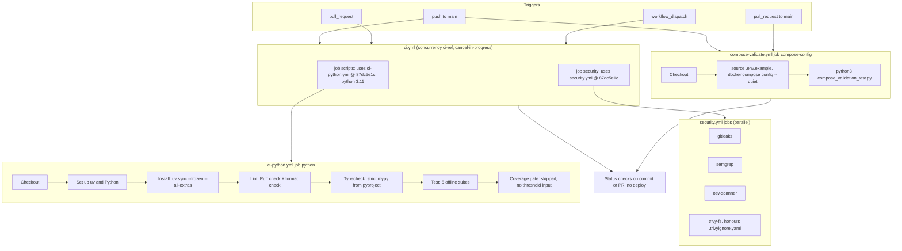
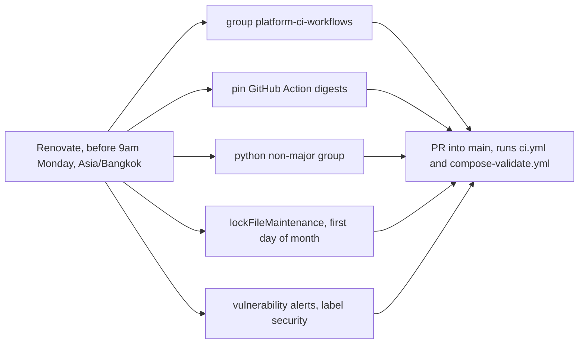

# 15 — CI/CD pipeline

มี 2 workflows ใน `.github/workflows/` และ **ไม่มี CD** (ไม่มี deploy job; `PRODUCT.md`: "nothing deploys from `main`") ทุก job รันบน GitHub-hosted runner เพราะ repo เป็น public

Test suites ใน step Test (จาก `test-command`): `compose_validation_test.py`, `frappe_dashboard_reader_test.py`, `frappe_fx_guard_test.py`, `mlops_observability_test.py`, `minio_policy_test.py`

Sources: `.github/workflows/ci.yml`, `.github/workflows/compose-validate.yml`, `pyproject.toml`, `.trivyignore.yaml`, platform-ci-workflows `.github/workflows/ci-python.yml` และ `.github/workflows/security.yml` @ `87dc5e1c7e0416886a6371d5a101bb2ccba38edd` (อ่านจาก local clone ของ platform-ci-workflows)

## Dependency automation

Sources: `renovate.json`

## Lab-internal CI (not GitHub)

`infra/self-hosted-stack/gitea/.woodpecker.yml` เป็น **ตัวอย่างสำหรับเรียนรู้** ของ Woodpecker ใน lab (lint → test → build เมื่อมี Dockerfile → deploy ที่แค่ `echo`) ไม่ได้ใช้กับ repo นี้ และ step test ใช้ `|| echo "No tests found"` จึงไม่ fail จริง

## Gaps

- `frappe/compose.yaml` และ `frappe/Containerfile` ไม่ถูก validate/build ใน CI
- `data-lake/Dockerfile` ไม่ถูก build (และ build ไม่ได้จาก repo นี้)
- ไม่มี required status checks เพราะ `main` ไม่มี branch protection
