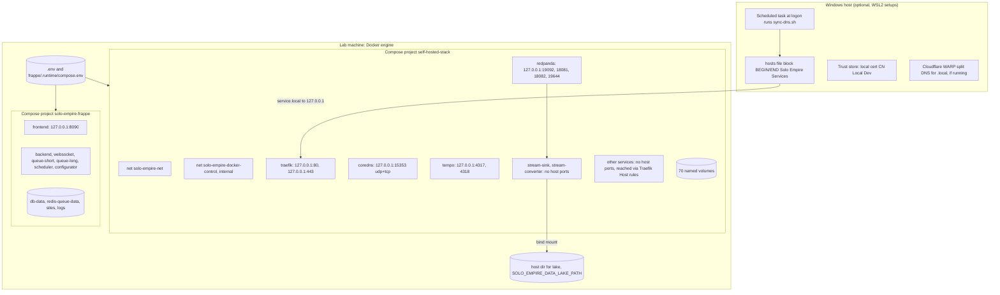

# 16 — Deployment

ไม่มี hosting provider (Vercel / Railway / Cloudflare) และไม่มี public domain — "deployment" คือการที่ owner รัน Compose บนเครื่อง lab เอง (WSL2 หรือ native Linux ตาม `PROFILES.md`) ด้วย `.env` local

Sources: `infra/self-hosted-stack/docker-compose.yml` (`ports`, `networks`, `volumes`, `x-data-lake-runtime`), `infra/self-hosted-stack/frappe/compose.yaml`, `infra/self-hosted-stack/frappe/README.md` (start/stop commands), `infra/self-hosted-stack/sync-dns.sh`, `infra/self-hosted-stack/setup-auto-dns.ps1`, `infra/self-hosted-stack/one-time-setup.ps1`, `infra/self-hosted-stack/hosts.solo-empire.fragment`, `infra/self-hosted-stack/PROFILES.md`

## Environments

| Environment | มีจริงไหม | หลักฐาน |
|---|---|---|
| Local lab | มี | ทั้ง repo |
| CI validation | มี (config only, ไม่รัน containers) | `compose-validate.yml` ใช้ `.env.example` |
| Staging / production | **ไม่มี** | `PRODUCT.md` "not hosted anywhere and has no live URL" |

## Images and build

- Third-party images ดึงจาก registries ตาม tag (pgbouncer ใช้ digest)
- `solo-empire-data-lake:local` build จาก `data-lake/Dockerfile` (context `..`) — ต้องมี `scripts/data_lake` และ `requirements-data-lake.txt` ซึ่งไม่อยู่ใน repo นี้
- Frappe custom image build จาก `frappe/Containerfile` บน base `solo-empire-frappe:16-candidate-payments-lmsfix` (local image, ไม่มีวิธี build base ใน repo); compose ใช้ `${CUSTOM_IMAGE}:${CUSTOM_TAG}` default `frappe/erpnext:v16.31.1`

## Open questions

- Base image `solo-empire-frappe:16-candidate-payments-lmsfix` ถูก build จากที่ไหน (คาดว่าจาก official `frappe_docker` + `apps.json` แต่ไม่มี script ใน repo)
- เครื่อง lab ปัจจุบันเป็น WSL2 หรือ native Linux (`PROFILES.md` บอก "may be native Linux")
