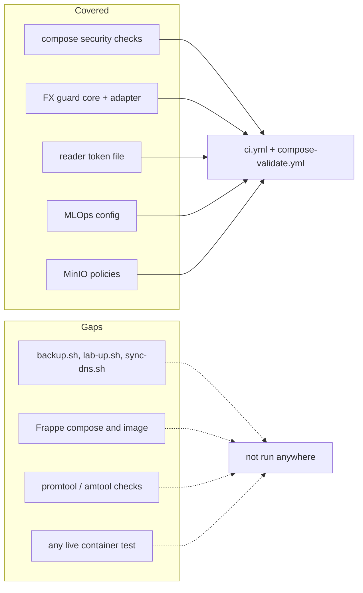

# 17 — Test coverage matrix

Test ทั้งหมดเป็น offline scripts (stdlib `unittest` หรือ assert functions) ไม่มี integration test ที่เปิด container จริง และไม่มี e2e ผลรันในเครื่องวันนี้ (2026-11-04): ทั้ง 5 suites ผ่าน (compose 21 checks passed, FX guard 7 tests OK, MLOps 3 OK, MinIO 6 OK, dashboard reader 2 asserts passed)

ระดับ: **unit** = ฟังก์ชันใน isolation; **static/config** = อ่านไฟล์ config แล้ว assert; **integration** = ต่อ service จริง; **e2e** = flow ผู้ใช้จริง

| Feature | Unit | Static / config | Integration | E2E | Test file |
|---|---|---|---|---|---|
| Compose security (localhost binds, socket allow-list, proxy isolation, `:latest` allow-list, env secrets) | — | ✅ | — | — | `infra/tests/platform/compose_validation_test.py` |
| Compose renders with placeholder env | — | ✅ (`docker compose config`) | — | — | `compose-validate.yml` step |
| FX guard `validate_observation` (pair, quality, provenance, time order, 24 h boundary, numbers, base currency) | ✅ | — | — | — | `infra/tests/integrations/frappe_fx_guard_test.py` |
| FX guard Frappe adapter (snapshot lookup, forged id, external lookup enabled) | ✅ (fake `frappe` module) | — | gap | gap | `frappe_fx_guard_test.py` `test_adapter_uses_trusted_snapshot_and_server_clock` |
| FX guard install/uninstall custom field | gap | — | gap | — | — |
| Dashboard reader token file write/parse | ✅ | — | — | — | `infra/tests/integrations/frappe_dashboard_reader_test.py` |
| Dashboard reader `run` / `verify_token` / REST client | gap | — | gap | — | — |
| MLOps observability (empty target, rules present, Grafana queries) | — | ✅ | — | — | `infra/tests/mlops/mlops_observability_test.py` |
| MinIO lake policies least privilege, no secrets | — | ✅ | gap (not applied to MinIO in test) | — | `infra/tests/data_lake/minio_policy_test.py` |
| Prometheus rules syntax (promtool) | — | gap | — | — | — |
| Alertmanager config validity | — | gap | — | — | — |
| `lab-up.sh` profile handling | gap | — | gap | — | — |
| `backup.sh` | gap | — | gap | — | — |
| `sync-dns.sh` and PowerShell helpers | gap | — | gap | — | — |
| Frappe compose / Containerfile | — | gap | gap | gap | — |
| Traefik routing / TLS | — | partial (bind + insecure flag only) | gap | gap | `compose_validation_test.py` |
| Lint + types for scripts and custom app | — | ✅ (ruff, strict mypy) | — | — | `ci.yml` via `ci-python.yml` |

Sources: `infra/tests/**`, `.github/workflows/ci.yml`, `.github/workflows/compose-validate.yml`, local run of the 5 suites listed in `README.md`

## Open questions

- ควรเพิ่ม `promtool check config/rules` และ `amtool check-config` ใน `compose-validate.yml` หรือไม่
- Coverage % ไม่ได้วัด (ไม่มี `coverage-threshold`)
