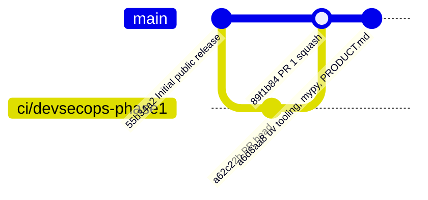
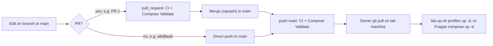

# 18 — Git & release workflow

ประวัติ `main` มี 3 commits (first-parent) และ 1 PR ที่ merge แล้ว ไม่มี tags/releases และไม่มี branch protection "Release" = commit ถึง `main` + CI เขียว จากนั้น owner ดึงไปเปิดบนเครื่อง lab เอง

หมายเหตุ: `git log --all` มีแค่ 3 commits — PR #1 (5 commits บน branch) ถูก squash เป็น `89f1b84`; ภาพแสดง branch เพื่อสื่อว่าผ่าน PR

Sources: `git log --first-parent origin/main`, `gh pr list --state all`, `gh pr view 1 --json commits`

## Flow from change to "production" (lab)

Sources: `.github/workflows/ci.yml`, `.github/workflows/compose-validate.yml`, `PRODUCT.md`, `gh api repos/bookchaowalit/platform-homelab-infra/branches/main/protection` (404 Branch not protected), `gh api repos/bookchaowalit/platform-homelab-infra/rulesets` (`[]`)

## Conventions seen

- commit message ผสม conventional (`ci: ...`) กับข้อความธรรมดา
- Renovate ใช้ `:semanticCommitTypeAll(chore)` และ label `dependencies`
- ยังไม่มี Renovate PR ใน `gh pr list` (มีแค่ PR #1)

## Open questions

- ควรเปิด branch protection / required checks บน `main` หรือไม่ (ตอนนี้ direct push ได้)
- ต้องการ tag/release สำหรับ lab snapshot หรือไม่
