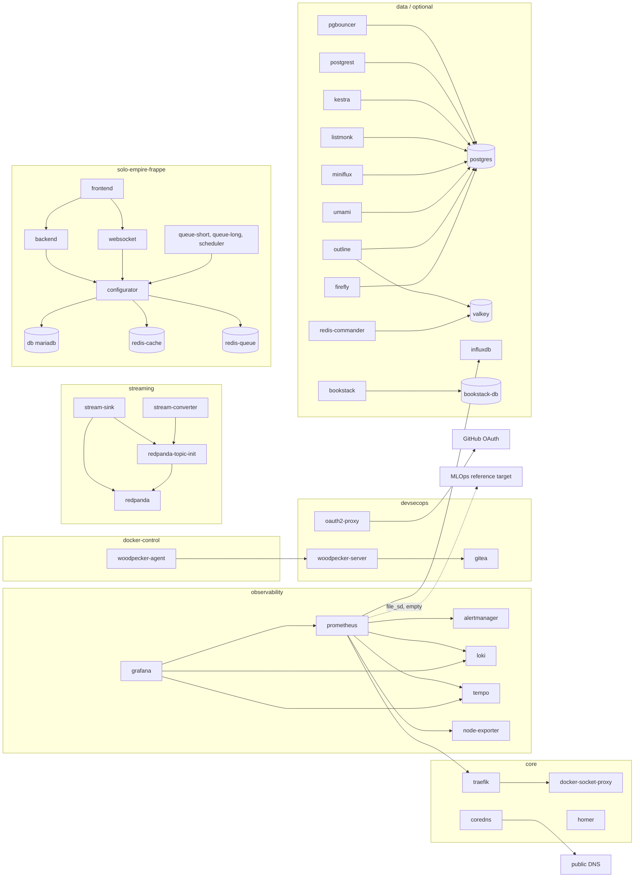

# 19 — Service dependency map

Runtime dependencies จาก `depends_on`, env/URL ใน config และ data sources ของ Grafana เส้นทึบ = `depends_on` หรือ connection ที่ config ระบุ, เส้นประ = dependency ที่ config อ้างแต่ไม่มีใน compose

Sources: `infra/self-hosted-stack/docker-compose.yml` (`depends_on`, `woodpecker-*` env, `oauth2-proxy` env, `stream-sink` command), `infra/self-hosted-stack/prometheus/prometheus.yml`, `infra/self-hosted-stack/grafana/provisioning/datasources/prometheus.yml`, `infra/self-hosted-stack/coredns/Corefile`, `infra/self-hosted-stack/frappe/compose.yaml`

## Missing dependencies (rules/config ที่ชี้ไปของที่ไม่มี)

- Rules `PostgresDown`, `PostgresHighConnections` ใช้ `pg_up`, `pg_stat_activity_count` — ไม่มี postgres exporter ใน compose
- Rule `RedisHighMemory` ใช้ `redis_memory_*` — ไม่มี redis exporter
- Rule `ContainerHighMemory` ใช้ `container_memory_*` (cAdvisor) — cAdvisor ไม่ได้อยู่ใน scrape config
- `gatus/config.yaml` มี 79 endpoints แต่ไม่มี service `gatus` ใน compose (และ endpoint Traefik ชี้ไป `:8088` ที่ปิดไว้)
- `backup.sh` อ้าง volumes ของ services ที่ไม่มีแล้ว (ดู [14-backup-dr.md](14-backup-dr.md))

## Open questions

- `stream-sink` / `stream-converter` ใช้ Schema Registry (`:8081`) หรือไม่ — ดูได้จากโค้ดใน data-lake repo เท่านั้น
