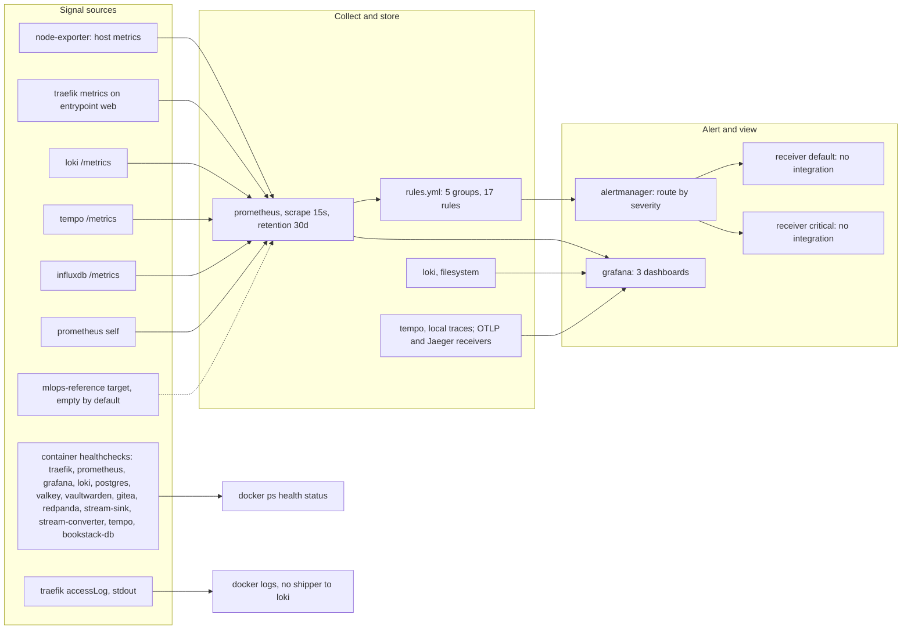

# 20 — Observability

repo นี้ **มี** stack observability ของ lab (Prometheus, Alertmanager, Grafana, Loki, Tempo, exporters) แต่ **ตัว repo เอง** ไม่มี Sentry / PostHog / uptime worker / heartbeat (`PRODUCT.md`: "Sentry waiver: IaC and lab compose stack only")

## Signal flow (ตาม config จริง)

Grafana dashboards (provisioned): "Solo Empire - System Metrics" (10 panels), "Solo Empire - Service Overview" (10 panels), "Solo Empire - MLOps Reference" (5 panels)

Sources: `infra/self-hosted-stack/prometheus/prometheus.yml`, `infra/self-hosted-stack/prometheus/rules.yml`, `infra/self-hosted-stack/prometheus/mlops-targets.json`, `infra/self-hosted-stack/alertmanager/alertmanager.yml`, `infra/self-hosted-stack/grafana/provisioning/datasources/prometheus.yml`, `infra/self-hosted-stack/grafana/provisioning/dashboards/*.json`, `infra/self-hosted-stack/loki/loki.yml`, `infra/self-hosted-stack/tempo/tempo.yml`, `infra/self-hosted-stack/traefik/traefik.yml`, `infra/self-hosted-stack/docker-compose.yml` (`healthcheck`), `PRODUCT.md`

## What is watched (alert rules)

| Group | Rules | Severity | Metric source present? |
|---|---|---|---|
| infrastructure | InstanceDown, InstanceHighCPU, InstanceHighMemory, InstanceDiskSpaceLow, InstanceDiskSpaceCritical, ContainerHighMemory | critical / warning | yes, except `container_*` (cAdvisor not scraped) |
| traefik | TraefikHighErrorRate, TraefikHighLatency | warning | yes (traefik job) |
| services | ServiceDown, PrometheusConfigReloadFailure, TooManyOpenFileDescriptors | critical / warning | yes |
| mlops-reference | MLOpsReferenceServingDown, MLOpsReferenceErrorRateHigh, MLOpsReferenceModelMissing | warning / critical | target file empty → inactive by design |
| databases | PostgresDown, PostgresHighConnections, RedisHighMemory | critical / warning | **no** exporters |

## Other monitoring present in compose (opt-in)

- `uptime-kuma` (profile `docker-control`) — monitors configured in its UI/volume, ไม่มีใน repo
- `diun` (profile `docker-control`) — image update watch ทุก 6 ชั่วโมง ไม่มี notifier config
- `blackbox-exporter`, `pushgateway`, `graphite` (profile `observability`) — ไม่ถูก scrape
- `cadvisor` (profile `docker-control`) — ไม่ถูก scrape
- `gatus/config.yaml` — config 79 endpoints แต่ **ไม่มี service gatus** ใน compose

## Ops records

ไม่พบ ops record ใน memory index ที่อ้างถึง repo นี้ (ค้นคำว่า "homelab" ใน `~/.claude/projects/-home-bookchaowalit/memory/*.md` ไม่พบ) — repo นี้ไม่อยู่ใน uptime Worker / heartbeat / posture monitor ที่บันทึกไว้

## Open questions

- ต้องการให้ Alertmanager ส่งไปช่องทางจริง (เช่น Telegram ที่ใช้กับระบบอื่น) หรือไม่ — ตอนนี้ alert ไม่ไปถึงใคร
- ต้องการเพิ่ม log shipper เข้า Loki หรือไม่ (stack README: "No Vector container is enabled")
