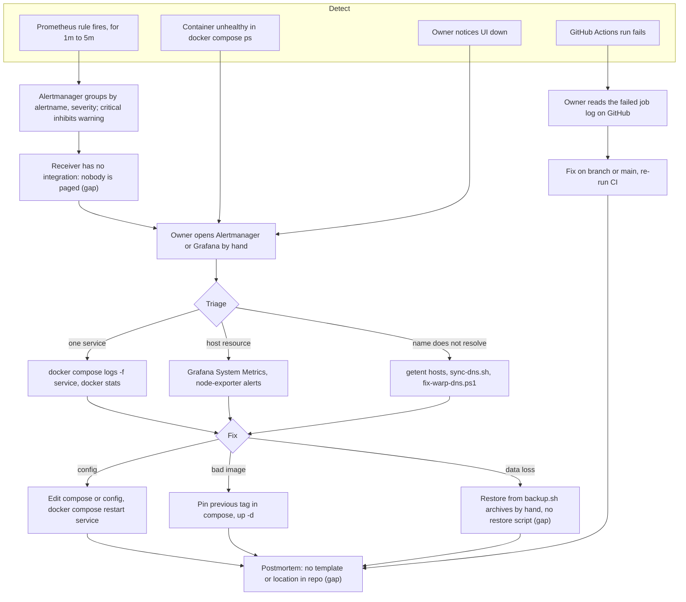

# 21 — Incident response

repo ไม่มี runbook หรือ on-call และ Alertmanager receivers (`default`, `critical`) **ไม่มี integration** ใด ๆ ดังนั้น "alert channel" ที่มีจริงมีแค่: (1) Alertmanager UI ผ่าน Traefik (2) Grafana dashboards (3) `docker compose ps` health status (4) GitHub Actions failure บน commit/PR flow ด้านล่างเป็นสิ่งที่ทำได้จากเครื่องมือที่มีใน repo พร้อมจุดที่เป็น gap

Sources: `infra/self-hosted-stack/alertmanager/alertmanager.yml`, `infra/self-hosted-stack/prometheus/rules.yml`, `infra/self-hosted-stack/README.md` (Common Commands), `infra/self-hosted-stack/PROFILES.md` (DNS troubleshooting), `infra/self-hosted-stack/fix-warp-dns.ps1`, `infra/self-hosted-stack/scripts/backup.sh`, `.github/workflows/*.yml`

## Frappe incidents

`SECURITY-READINESS.md` "Review triggers" ระบุให้ re-run security review หลัง "incident" แต่ไม่มีขั้นตอน incident เอง; backup/restore ของ Frappe เป็น drill ที่ทำมือ (ไม่มี script ใน repo)

## Gaps

- ไม่มี notification channel (Telegram/email/webhook) ใน Alertmanager
- ไม่มี runbook, severity matrix, postmortem template
- Autoheal (opt-in) อาจไม่ restart อะไรเลยเพราะไม่มี container ติด label (ดู [11-state-machines.md](11-state-machines.md))

## Open questions

- Lab นี้ต้องการ incident process ไหม หรือยอมรับ "owner ดูเองเมื่อใช้งาน" (ไม่มี production users ตาม `PRODUCT.md`)
