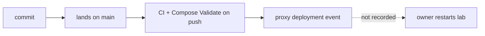

# 22 — DORA metrics

Window: 90 วันถึงวันนี้ (2026-08-06 → 2026-11-04) repo นี้ **ไม่มี deployment pipeline** (`PRODUCT.md`: "nothing deploys from `main`") จึงนิยาม "deployment" แบบ proxy ว่า **change landed on `main` with green CI** และระบุไว้ทุกตัวว่าไม่ใช่ production deploy จริง การเปิดใช้บน lab machine ไม่ถูกบันทึกที่ใดจึงวัดไม่ได้



Sources: `PRODUCT.md`, `.github/workflows/*.yml`

## 1. Deployment frequency

- วิธีวัด: จำนวน first-parent commits บน `main` ใน 90 วัน
- ค่า: **3 changes / 90 days** (~0.23 ต่อสัปดาห์; 2026-10-12, 2026-10-17, 2026-10-23) — production deploys = **0**

```bash
git log --first-parent origin/main --since=2026-08-06 --format='%h %cI %s'
# a6d8aa8 2026-10-23T22:05:34+07:00 Add uv-locked dev tooling, strict mypy, PRODUCT.md; shared CI v1.1.1
# 89f1b84 2026-10-17T16:44:07+07:00 ci: adopt the shared CI and security workflows (DevSecOps Phase 1) (#1)
# 55b34a2 2026-10-12T16:15:10Z Initial public release
```

## 2. Lead time for changes

- วิธีวัด: เวลาจาก commit แรกของ change ถึงตอนที่ change อยู่บน `main` (PR: first commit → `mergedAt`; direct push: commit time → first `push` run บน `main`)
- ค่า:
  - PR #1: 2026-10-17T09:22:17Z → 09:44:07Z = **21 นาที 50 วินาที**
  - `a6d8aa8` (direct push): commit 15:05:34Z → push run 15:05:39Z = **~5 วินาที** (เวลาจาก commit ถึง push ไม่สะท้อนเวลาทำงานจริง)
  - `55b34a2` (initial import): 16:15:10Z → push run 16:15:40Z = **~30 วินาที**
  - Median: **~30 วินาที**; ไม่รวมเวลาไปถึง lab (ไม่ถูกบันทึก)

```bash
gh pr view 1 --json commits,createdAt,mergedAt
gh run list --limit 50 --json workflowName,event,headBranch,headSha,createdAt,conclusion
```

## 3. Change fail rate

- วิธีวัด: changes บน `main` ที่ตามด้วย CI fail บน `main`, revert หรือ hotfix / ทั้งหมด
- ค่า: **0 / 3 = 0%** — ทุก run บน `main` (CI 2 runs, Compose Validate 3 runs) `success`; ไม่มี revert

```bash
gh run list --branch main --json workflowName,conclusion,headSha
git log origin/main --since=2026-08-06 --oneline -i --grep=revert
```

## 4. Failed deployment recovery time

- ค่า: **not computable** — ไม่มี failed change ใน window และไม่มี deploy event จริงให้วัด

## 5. Deployment rework rate

- วิธีวัด: changes ที่เป็นการแก้ change ก่อนหน้าแบบไม่ได้วางแผน (revert / fix-forward ของ change ที่เพิ่ง land) / ทั้งหมด
- ค่า: **0 / 3 = 0%** (`a6d8aa8` ต่อยอด tooling ไม่ได้แก้ความเสียหายของ `89f1b84`; ไม่มี revert)

```bash
git log --first-parent origin/main --since=2026-08-06 --format='%h %s'
```

## Caveats

- Sample เล็กมาก (3 changes) ค่าทั้งหมดไม่มีนัยทางสถิติ
- ไม่มี production / lab rollout log จึงวัด lead time ถึงผู้ใช้ไม่ได้
- ถ้าต้องการ DORA จริง ต้องมี event ที่บันทึกการ `up -d` บน lab (เช่น log ไฟล์หรือ heartbeat) — ยังไม่มี

## Open questions

- ควรนับ "deployment" ของ IaC lab เป็น merge-to-main ตามที่ใช้ที่นี่ หรือเป็นการ rollout บน lab machine
